# MaoLog · 电脑使用自动复盘

> 每隔一段时间截一次屏，用 AI 看懂你在做什么，晚上给你一份「今天到底干了什么」的复盘。
>

**这是「楚师智学」平台的一期引擎。** 

---

## 界面预览

### 主看板（时间轴 · 分类占比 · 应用排行 · 今日复盘）
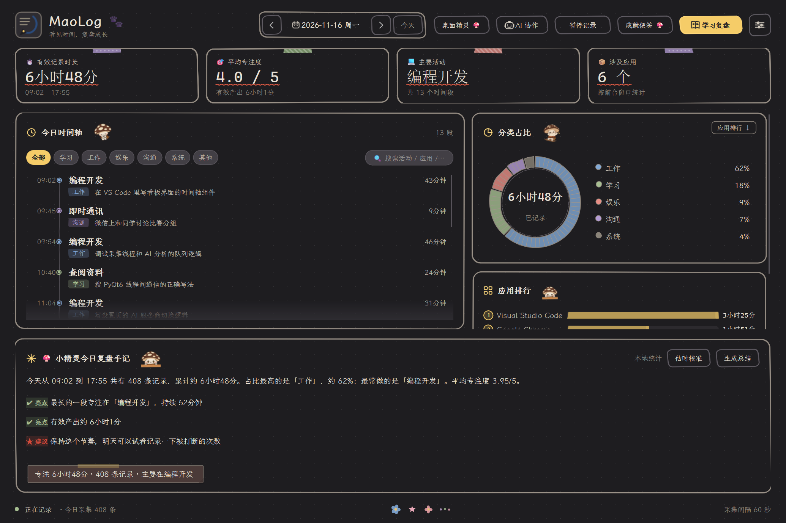

### 学习复盘与节奏分析
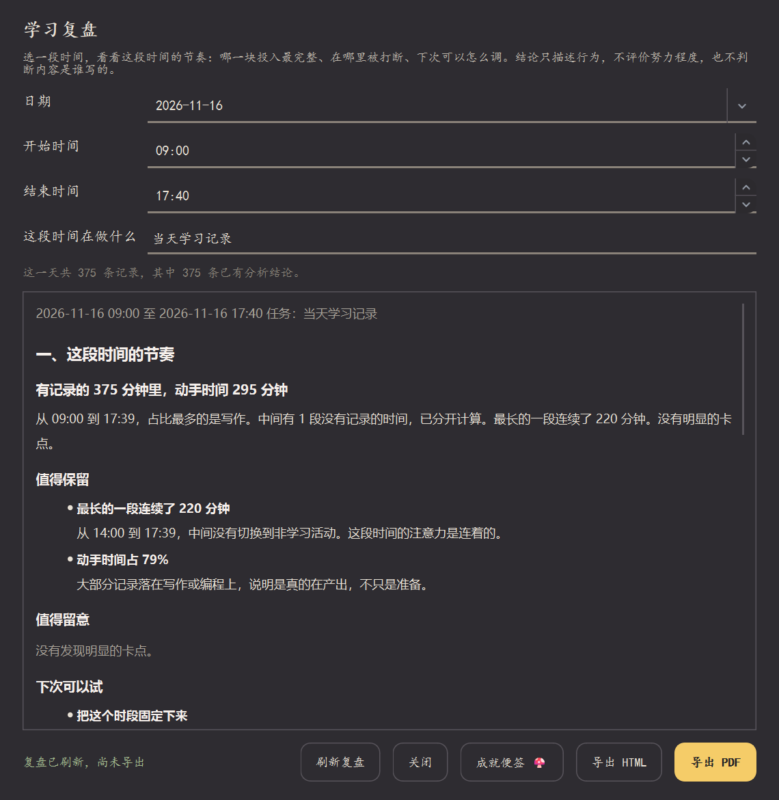

---

## 它解决什么问题

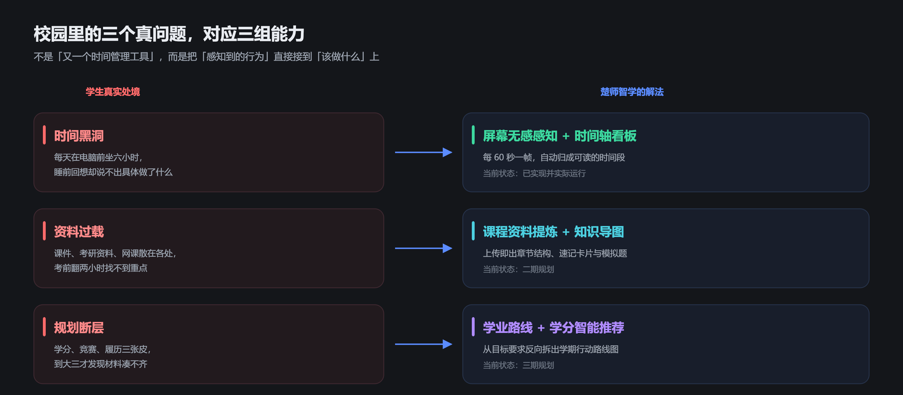

大多数人对"今天时间花哪了"的判断是失真的。凭感觉回忆，写代码的四小时和刷手机的一小时会被记成"我今天挺忙的"。

MaoLog 不靠自觉打卡，也不靠手动记录——它在后台默默截屏，让视觉大模型自己看你在干什么：

- 你在 VS Code 里改 `analyzer.py` → 记成「工作 · 编程开发」
- 你在浏览器看机器学习第 3 讲 → 记成「学习 · 网课学习」
- 你在 B 站看了四十分钟装机视频 → 记成「娱乐 · 视频观看」，并在当日复盘里点出来

晚上打开看板，时间轴、分类占比、应用排行一目了然；点一下「生成总结」，AI 会告诉你今天时间怎么分配的、哪段最专注、明天可以改什么。

---

## 三个核心设计

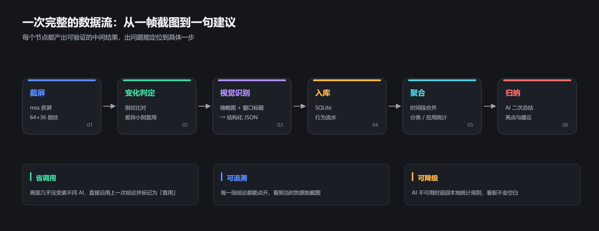

**1. 截图 + 窗口信息双通道识别**

只看截图，AI 容易把「深色界面」都认成写代码。MaoLog 同时抓前台窗口的进程名和标题（`analyzer.py - Visual Studio Code`），作为 AI 的辅助线索。准确率比纯截图高一大截。

**2. 画面变化检测，省钱又连续**

每张图会算一个 64×36 的画面指纹。和上一帧比差异很小时，不重复调 AI，直接沿用上次结论并标记为「复用」。实测能省掉 60% 以上的调用——同一件事持续做，没必要每分钟都问一遍。

**3. 隐私优先，本地闭环**

- 截图只存在你自己的磁盘，按日期分文件夹
- 只有压缩到 1024 宽的缩略图会发给 AI，原图不出本机
- 密码类软件（KeePass、1Password）出现时直接跳过；窗口标题含「密码」「银行卡」等词也不截
- 托盘一键暂停，随时停机

---

## 快速开始

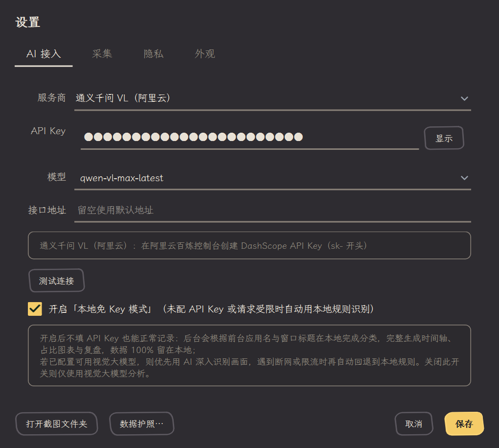

### 1. 装依赖

```bash
cd C:\Users\19351\Desktop\mao
.venv\Scripts\python.exe -m pip install -r requirements.txt
```

如果没有 `.venv`，先建一个：

```bash
uv venv --python 3.13 .venv
.venv\Scripts\python.exe -m pip install -r requirements.txt
```

### 2. 配一个 AI

双击或命令行启动：

```bash
.venv\Scripts\python.exe main.py
```

首次启动会提示你填 API Key，点「去设置」。推荐两个国内直连的方案：

| 服务商 | 模型 | 费用 | 说明 |
|---|---|---|---|
| 智谱 GLM-4V | `glm-4v-flash` | 目前免费 | 想零成本演示就选这个 |
| 通义千问 VL | `qwen-vl-max-latest` | 有免费额度，之后每千次约 1–3 元 | 识别精度更高 |

填完点「测试连接」，出现「连接成功」就可以保存了。

### 3. 让它跑着

程序会缩到右下角托盘，按设置的间隔（默认 60 秒）自动截屏分析。想看效果时点托盘图标打开看板。

> **没有 API Key 也想先看看界面？**
> 可以先跑演示数据：`.venv\Scripts\python.exe tools\seed_demo.py`，
> 再用 `.venv\Scripts\python.exe tools\preview_ui.py` 生成一张看板效果图。

---

## 看板怎么读

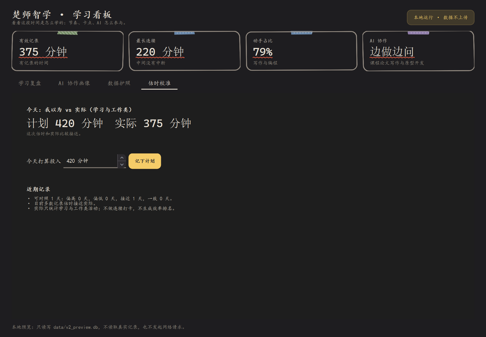

| 区域 | 含义 |
|---|---|
| 顶部四张卡 | 有效记录时长、平均专注度、主要活动、涉及应用数 |
| 今日时间轴 | 一天的活动按时间排开，色点对应分类；点某一段可以看当时的屏幕截图 |
| 分类占比 | 工作 / 学习 / 娱乐 / 沟通 / 系统 / 其他 的时间构成 |
| 应用排行 | 哪个软件占用时间最多 |
| AI 今日总结 | 整天的复盘 + 两条亮点 + 一条改进建议 |

左上角的 `‹ ›` 可以往前翻历史日期，`今天` 一键跳回。窗口高度较小时，右侧图表列会独立滚动，并在分类卡右上角显示「应用排行 ↓」入口，不会把两张卡硬压到互相裁切。


---

## 界面外观：两套手绘皮肤

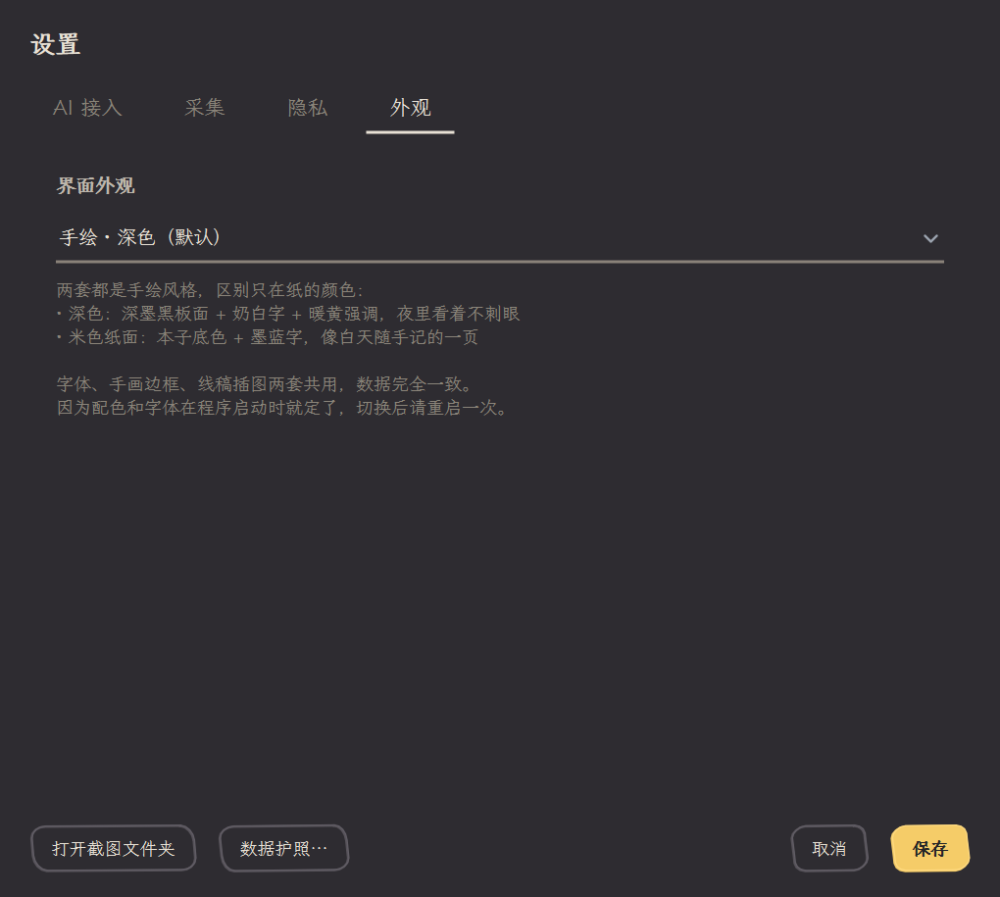

设置 → **外观** 里切换：

| 皮肤 | 样子 |
|---|---|
| 手绘 · 深色（默认） | 深墨黑板面 `#1B1A17` + 奶白字 + 暖黄强调，夜里看不刺眼 |
| 手绘 · 米色纸面 | 米色纸底 `#F8F4E9` + 墨蓝字，像白天随手记的一页 |

两套共用同一套手绘绘制代码：霞鹜文楷、手画边框、抖动圆环、红笔批注、线稿插图都一致，只有调色板和纸张纹理不同。

切完**需要重启一次**才生效——配色和字体是启动时加载的，保存时会弹窗提醒。

配置项 `ui.skin`（`dark` / `paper`）。开发时用环境变量临时预览：

```bash
MAO_DOODLE=1 main.py    # 米色纸面
MAO_DOODLE=2 main.py    # 深色（默认）
```

### 深色皮肤的插图处理

线稿插图是深色线条透明底，放到深色底上会看不见。深色皮肤使用单独的 `*-light.png`：

1. 把线条颜色统一改成奶白 `#EDE6D2`
2. 用 alpha 膨胀把线加粗约 1px（`ImageFilter.MaxFilter(3)`），否则细线在深底上太弱

生成脚本见 `assets/doodle/*-light.png` 的来源（由原图批量转换）。

两套皮肤数据完全一致，随时可以换回来。

---

## 界面与图标

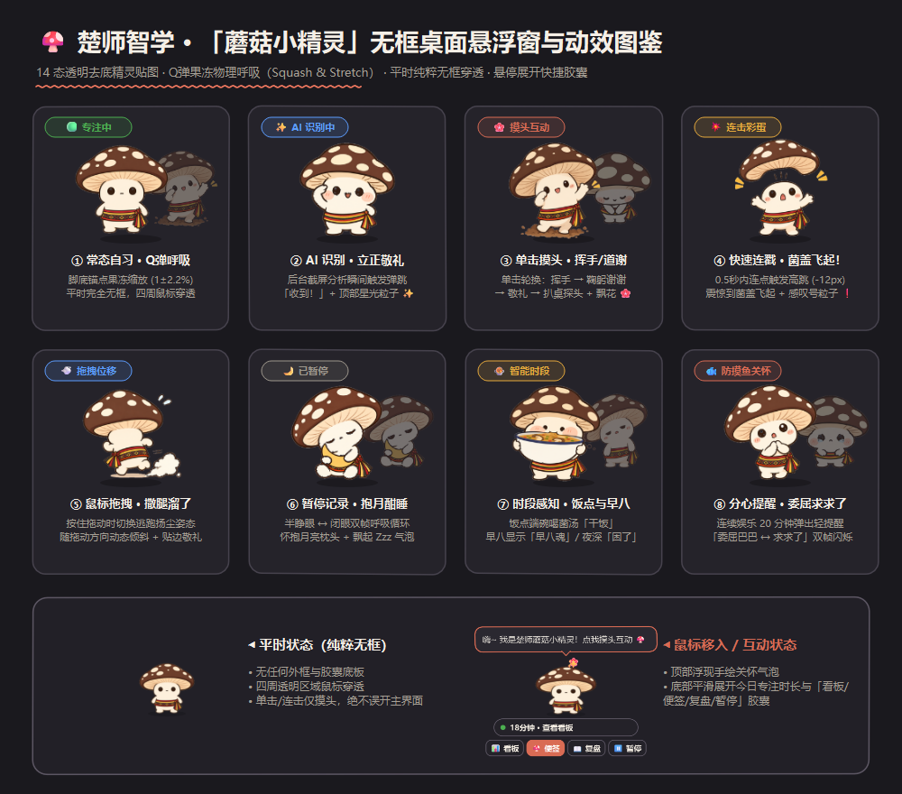

视觉方向是「克制的时间工作台」：墨青黑打底、低对比发丝边框，青玉色只留给主行动和关键状态；工作、学习、娱乐等颜色仅在图表里承担分类语义。顶栏拆成品牌区、日期导航和操作区，**「学习复盘」是唯一主按钮**，其余功能退到次级层级。

### 启动画面

每次启动会先显示一个 420×300 的无边框品牌页：品牌标记、产品名、「看见时间，复盘成长」、当前初始化阶段和三点呼吸动画。它参考了 Mineradio 的启动节奏，但使用 MaoLog 自己的青玉品牌，不复制其页面或资源。

- 状态来自真实初始化阶段，不是固定动画：检查本地数据 → 准备看板 → 连接记录引擎 → 启动托盘。
- 只保留 350ms 的最低可见时间，避免快机器上闪一帧；初始化更久时不会额外拖延。退出用 180ms 淡出。
- 如果配置了“启动时最小化”，启动页结束后直接进入托盘；托盘不可用时仍会显示窗口，避免程序无法找回。
- 自动化场景可设 `MAO_NO_SPLASH=1` 跳过启动页。
- 交互不是必须的：启动页不抢输入焦点，启动过程中也不会被误关闭。

```bash
.venv\Scripts\python.exe tools\test_startup.py
.venv\Scripts\python.exe tools\preview_splash.py
```

### 品牌图标

品牌符号是一条折返的时间轨迹，末端收成笔尖：记录时间，也留下自己的产出。所有界面图标和应用图标都由代码绘制，不依赖外部图片或系统图标：

- `ui/brand.py`：品牌绘制、界面小图标、字形和资源导出。
- `ui/theme.py`：全局颜色令牌与 QSS。
- `assets/icon.png` / `icon-256.png` / `icon.ico`：窗口、任务栏、托盘和打包共用。
- ICO 的 16–256px 每一档单独绘制；16px 会主动省略细刻度，保证小尺寸不糊成脏点。

重新生成图标：

```bash
.venv\Scripts\python.exe -c "from ui.brand import save_brand_assets; save_brand_assets('assets')"
```

检查界面的最小尺寸与默认尺寸：

```powershell
.venv\Scripts\python.exe tools\preview_ui.py data\preview_ui.png
$env:MAO_PREVIEW_WIDTH=1080; $env:MAO_PREVIEW_HEIGHT=720
.venv\Scripts\python.exe tools\preview_ui.py data\preview_min.png
```

---

## 配置项说明

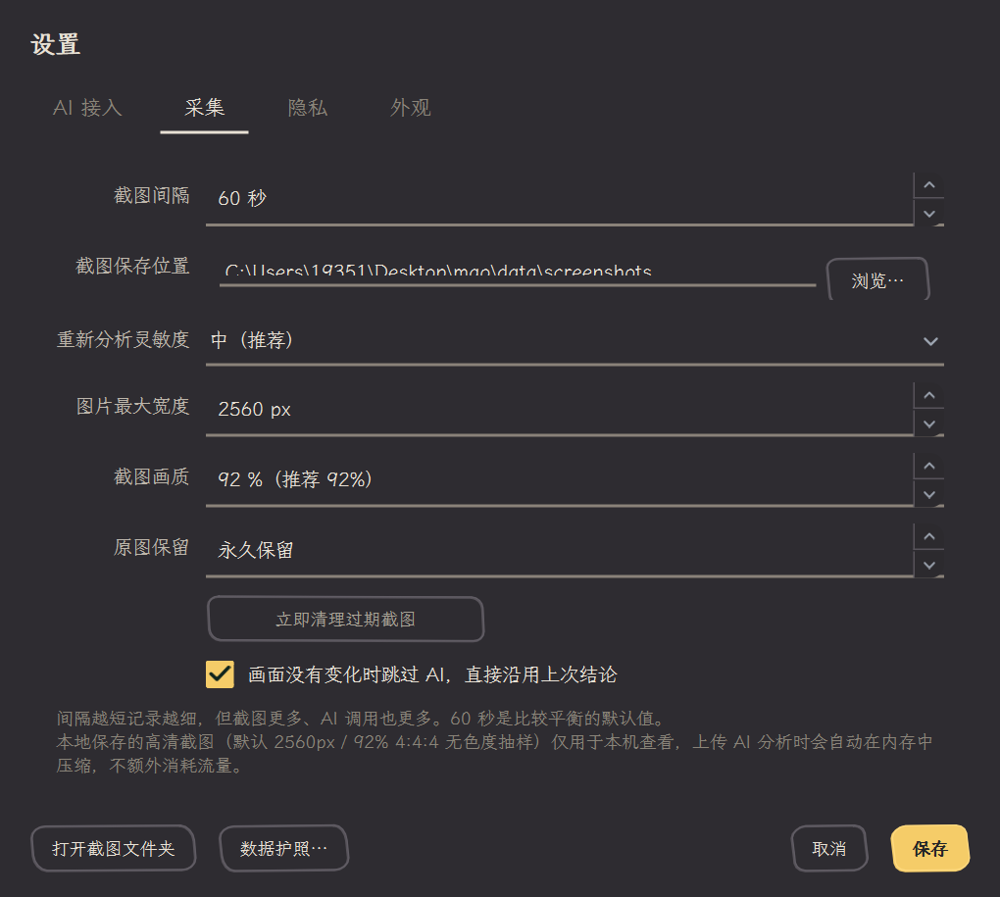

设置面板分三页：

**AI 接入**
- 服务商：通义千问 / 智谱 / OpenAI 兼容 / 本地 Ollama
- 接口地址留空则用各家默认值。如果你用的是豆包、Kimi 这类兼容 OpenAI 协议的服务，选「OpenAI 兼容接口」再填自己的地址即可
- 「测试连接」会发一条极小的请求，不消耗额度

**采集**
- 截图间隔：默认 60 秒。间隔越短越细致，但 AI 调用也越多
- 截图保存位置：点「浏览」选你想要的文件夹，程序会自动在里面按 `2026-10-23/` 建日期子目录
- 重新分析灵敏度：画面变化多大才重新问 AI。中档是推荐值
- 原图保留：设成 0 是永久保留，设成 7 就只留最近一周

**隐私**
- 排除的应用：一行一个，比如 `KeePass.exe`
- 敏感关键词：窗口标题命中就不截图


---

## 工作原理

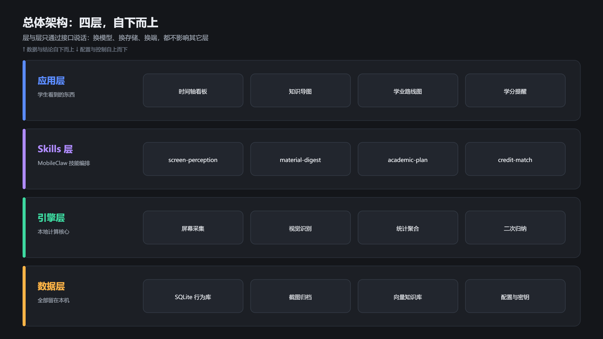

```
┌──────────────┐   每 60 秒    ┌──────────────┐
│  截屏线程     │ ───────────> │  captures    │
│ mss + user32 │  存原图+指纹  │  (SQLite)    │
└──────────────┘               └──────┬───────┘
                                       │ pending 队列
┌──────────────┐   结构化 JSON  ┌──────▼───────┐
│  分析线程     │ <──────────── │  AI 视觉模型  │
│  串行调用     │ ────────────> │ 分类/活动/专注 │
└──────────────┘                └──────────────┘
                                       │
                              ┌────────▼────────┐
                              │  PyQt6 看板      │
                              │ 时间轴/环形图/总结 │
                              └─────────────────┘
```

截屏和分析跑在两个独立线程，用数据库当队列解耦。AI 一次要 5–15 秒，但卡不住截屏节奏；截屏也不会拖慢请求。

技术栈：Python 3.13 + PyQt6 + mss + SQLite + Pillow，图表全部用 `QPainter` 自绘（不依赖 QtCharts，包体更小、样式更可控）。

---

## 目录结构

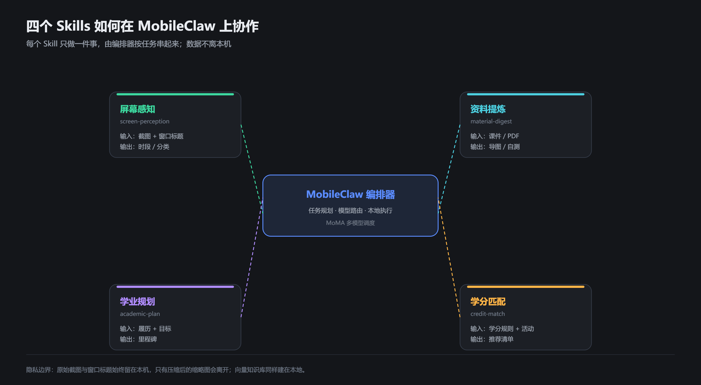

```
mao/
├── main.py                 时间记录程序入口：单实例锁、托盘、线程装配
├── core/
│   ├── config.py           配置读写（JSON，深合并，线程安全）
│   ├── capture.py          截屏 + 窗口信息 + 画面指纹 + 隐私拦截
│   ├── ai_client.py        四家服务商统一适配，异常转中文
│   ├── analyzer.py         采集线程 + 分析线程 + 调度
│   ├── wallpaper.py        壁纸来源工具（本地图片校验、读取桌面壁纸路径）
│   ├── storage.py          SQLite 数据层、时间段合并、统计聚合
│   └── daily.py            每日摘要构造与总结生成
├── ui/
│   ├── theme.py            视觉令牌与全局样式表
│   ├── brand.py            品牌/界面图标绘制与 ICO 导出
│   ├── splash.py           无边框品牌启动页与淡出
│   ├── components.py       统计卡、环形图、应用排行、渐隐层
│   ├── timeline.py         时间轴（自绘，几百条也不卡）
│   ├── main_window.py      看板主窗口
│   ├── settings_dialog.py  设置面板
│   └── tray.py             系统托盘
├── assets/                 下拉箭头、品牌图标、示例壁纸与文档配图
├── tools/                  开发辅助：演示数据、UI 预览、链路测试、mock AI
├── data/                   时间记录的运行时数据（配置、数据库、截图、日志）
```

---

## 常见问题

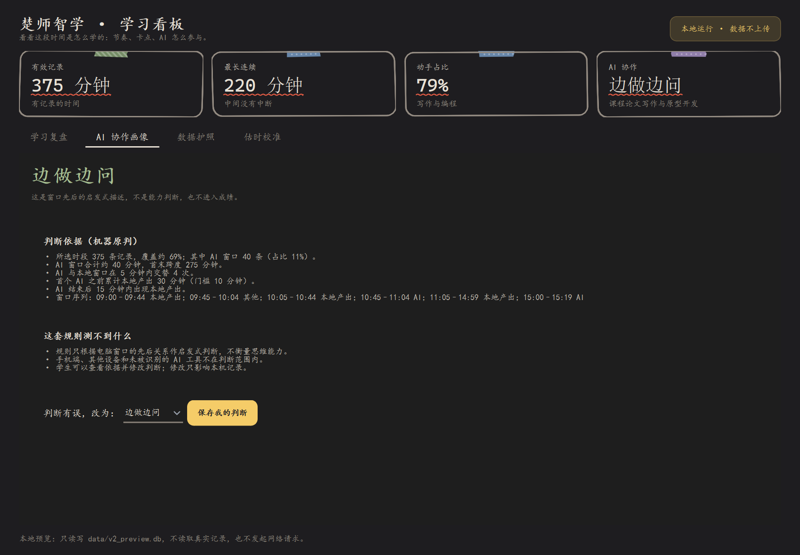

**Q：一启动就提示「已经在运行」？**
程序有单实例保护，防止两个进程重复截图。看右下角托盘，它可能已经缩在那儿了。

**Q：状态栏显示「未配置 AI」，时间轴一直是空的？**
说明只采集没分析。去设置里填 API Key，点「测试连接」确认能通。已经截好的图会排队补分析。

**Q：AI 分析很慢 / 一直转圈？**
本地 Ollama 跑 7B 模型每张要 3–8 秒，属正常。换云端模型会快很多。

**Q：截图太占空间？**
原图 1600 宽、JPEG 质量 80，一张约 100–200KB。按 60 秒一次算，一天 8 小时大概 60–90MB。嫌多可以在设置里把「原图保留」改成 7 天。

**Q：能记录多台电脑吗？**
当前是单机版，数据存在本机 `data/activity.db`。多机同步不在本期范围内。

---

## 开发辅助脚本

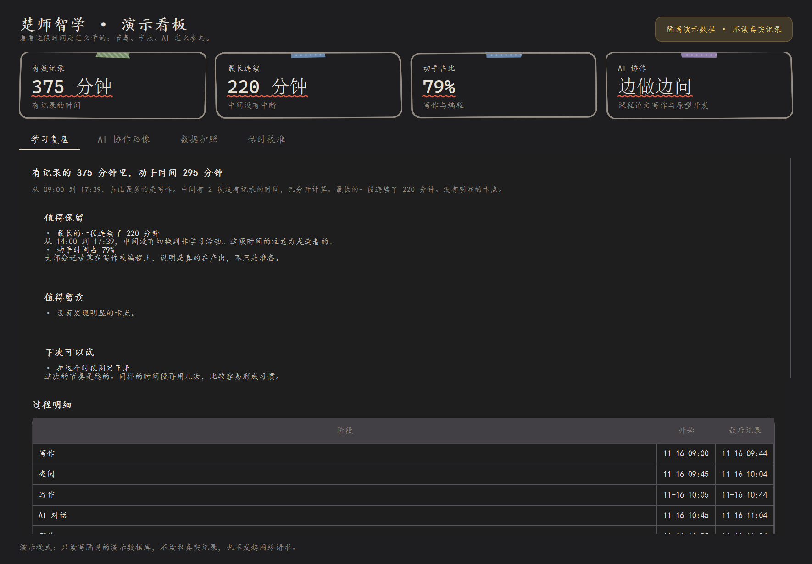

| 脚本 | 作用 |
|---|---|
| `tools/seed_demo.py` | 生成一整天的演示数据到 `data/demo.db` |
| `tools/preview_ui.py` | 把看板渲染成 PNG，支持 `MAO_PREVIEW_WIDTH/HEIGHT` 检查不同窗口尺寸 |
| `tools/preview_v2.py` | 生成隔离的学习复盘 PDF、护照和全部对话框截图 |
| `tools/preview_splash.py` | 渲染品牌启动页截图，不弹出真实启动窗口 |
| `tools/test_v2.py` | 学习复盘、AI 协作、护照、估时与隔离演示的完整回归 |
| `tools/test_startup.py` | 启动页状态、防止误关闭和淡出回调回归 |
| `tools/test_pipeline.py` | 端到端测试：采集→分析→入库→统计→总结 |
| `tools/mock_ai_server.py` | 本地假 AI 服务，没有 Key 也能跑通全流程 |
| `tools/smoke_test.py` | 启动冒烟测试，验证窗口/托盘/线程都正常 |

跑测试：

```bash
.venv\Scripts\python.exe tools\test_v2.py
```

---

## 学习复盘（v2）

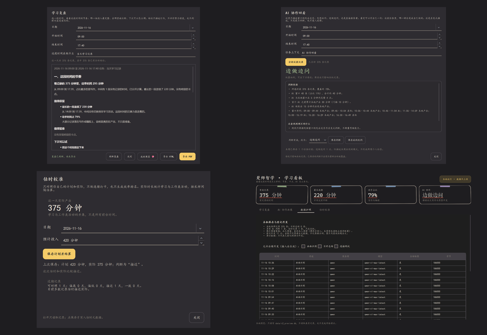

一期回答"时间花在哪了"，这一层回答"这段时间是怎么学的"。

主窗口右上角 **「学习复盘」**：

- 选日期和时段，先看结论：有效记录多少分钟、最长连续投入多长、动手占比多少、被打断几次。
- 再往下是三块：**值得保留**（节奏上做对的地方）、**值得留意**（卡点）、**下次可以试**（一条能执行的动作）。
- 确认后导出 PDF/HTML。只读快照，不创建 v2 表，不改一期数据。

**「AI 协作」** 看的是同一段时间里 AI 怎么参与：先想后问、边做边问，还是直接要答案，可查看依据并改判。

**「估时校准」** 在"AI 今日总结"卡片右上角，对照计划和实际产出；保存才写估时元数据。

**「数据护照」** 在设置页：台账开关、用途策略、护照导出和按日清理。它是支撑层，不占主入口。

**「演示」** 用隔离的 `data/v2_demo/` 打开四页签看板，不读取真实记录。

```bash
.venv\Scripts\python.exe tools\preview_v2.py --reset
.venv\Scripts\python.exe tools\test_v2.py
```

产物在 `data/v2_preview/`：学习复盘 PDF、数据护照 JSON、四张界面截图。

- 默认只读写 `data/v2_preview/v2_preview.db`，不碰 `data/activity.db`。
- 不发起网络请求，不读取作业正文，导出默认不含截图和窗口标题全文。
- 不改 `main.py`，也不改一期表结构。

实盘外发台账默认关闭。可在 **设置 → 数据护照…** 里开启、查看策略、导出护照和按日清理；也可以使用命令行：

```bash
.venv\Scripts\python.exe tools\v2_ledger.py enable
.venv\Scripts\python.exe tools\v2_ledger.py status
.venv\Scripts\python.exe tools\v2_ledger.py passport
.venv\Scripts\python.exe tools\v2_ledger.py cleanup 2026-10-27 --yes
```

默认只记录、不拦截；`enable --enforce` 才会按用途开关阻止请求。关闭时不建表、不写记录。

---

## 打包成 exe

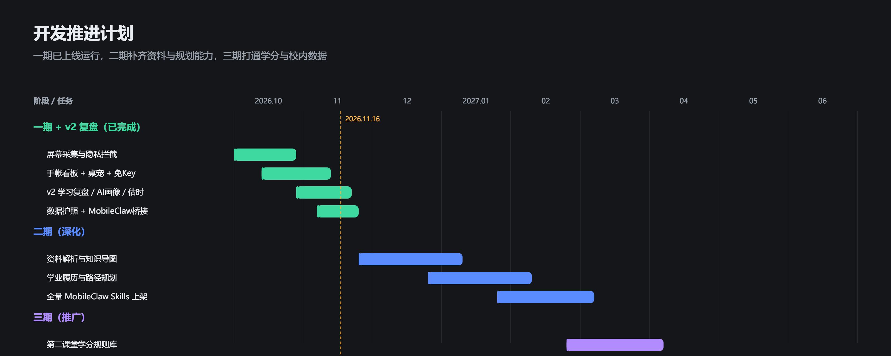

```bash
.venv\Scripts\python.exe -m pip install pyinstaller
.venv\Scripts\python.exe tools\build_exe.py
```

打包脚本会先调用 `ui.brand.save_brand_assets()` 生成与界面同源的 `assets/icon.ico`，再交给 PyInstaller，所以窗口、任务栏、托盘和 exe 文件不会是四套图标。产物在 `dist\MaoLog\`；`data` 目录会在 exe 同级自动创建，截图和数据库都跟着走。

**只读资源和可写数据是分开算的**（`core/paths.py`）：

| 类型 | 源码运行 | 打包后 | 原因 |
|---|---|---|---|
| `assets/`（字体、插画、图标） | 仓库根目录 | `_internal/assets`（`sys._MEIPASS`） | PyInstaller 把它解到临时目录，只能读 |
| `data/`（配置、数据库、截图） | 仓库根目录 | exe 同级 | `_MEIPASS` 退出即删，写入会丢 |

所以**不要**再用 `Path(__file__).parent.parent` 拼资源路径——打包后它指向解包目录内部，层级和源码不一致。统一走 `core.paths.asset_dir()` / `data_root()`。

内置字体（霞鹜文楷 Regular + Medium，约 50 MB）和手绘插画都在 `assets/` 下，`--add-data assets;assets` 会一起打进去。

**实测产物**（2026-11-02，不含 QtWebEngine）：`dist\MaoLog` 共 167 MB

| 组成 | 大小 |
|---|---|
| PyQt6 运行时 | 73 MB |
| assets（字体 + 插画 + 图标） | 55 MB |
| Pillow | 11 MB |
| 其余 DLL + 代码 | 约 28 MB |

打包耗时约 30 秒。启动后会在 exe 同级自动建 `data/`，日志里能看到 `已加载内置字体: LXGW WenKai, 霞鹜文楷 …`，说明字体链路正常。

---

## 隐私声明

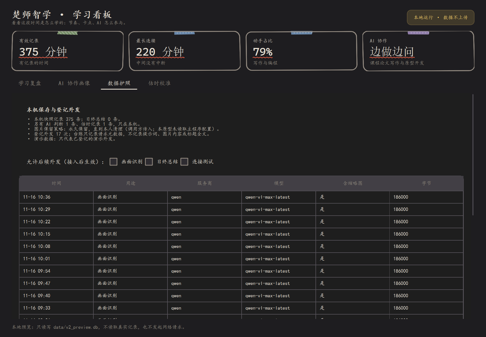

本工具会定时截取你的屏幕并保存在本机，仅当前用户可访问。
只有压缩后的缩略图（1024 宽 JPEG）会发送给你配置的 AI 服务商用于识别内容。
原始截图、窗口标题、使用统计全部保存在本机 SQLite，不上传任何服务器。


随时可以通过托盘菜单暂停或退出。
