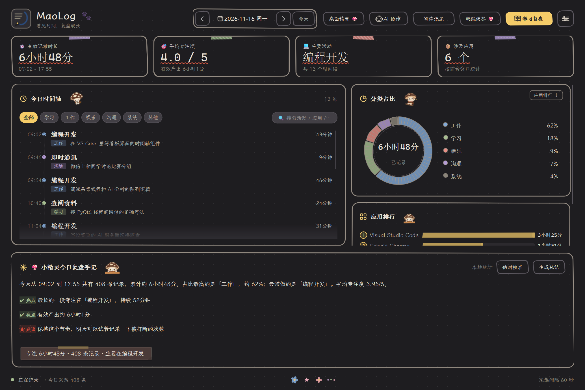
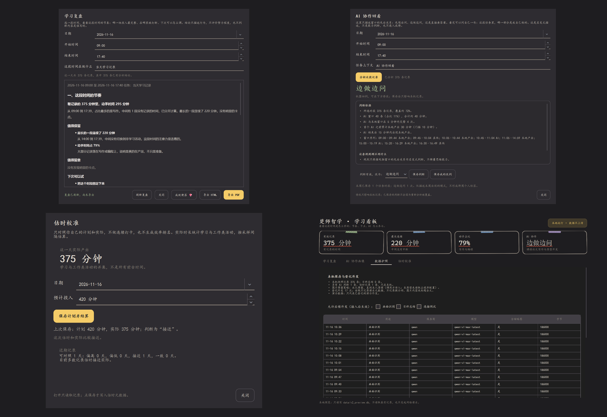
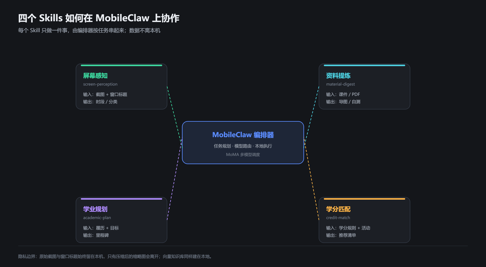

# 「楚师智学」创作过程记录

**作品名称**：楚师智学——基于屏幕感知与 MobileClaw 的主动式 AI 个人学业管理平台  
**参赛主题**：主题一「AI 赋能校园」——校园应用创意方案  
**参赛人**：李政寰（学号：20240524140，2024级数字媒体技术班）　　**记录周期**：2026 年 10 月 — 2026 年 11 月  

---

## 一、使用的 AI 平台与工具清单

| 平台 / 工具名称 | 使用环节 | 核心作用说明 |
|---|---|---|
| **中国移动 MobileClaw** | 创意推敲、Skills 架构与下游调度验证 | 借助 MobileClaw 的 Skills 技能包思路完成能力拆分与 `chushi-zhixue-bridge` 桥接验证，领取免费 2500 万 Token 用于日常总结与规划提示词试验 |
| **智谱 GLM-4V-Flash / 通义千问 VL** | 视觉大模型接入验证 | 验证屏幕缩略图 + 窗口标题双通道识别 JSON 稳定率，以及日终 40 段摘要二次归纳质量 |
| **本地 Ollama（`qwen2.5vl`）** | 离线推理对比测试 | 验证完全断网场景下的桌面视觉分类表现与响应耗时边界 |
| **本地免 Key 规则引擎（自研）** | 离线降级与个人纠偏记忆 | 无 API Key 时按进程名、窗口标题关键词及用户右键纠偏记忆本地自动归类 |

---

## 二、关键提示词工程与迭代过程

创作遵循「**人定边界与架构 → AI 协助试错与验证 → 实机数据纠偏定稿**」的链路，核心经历了四次关键迭代：

### 阶段 1（10 月中下旬）：痛点聚焦与「双通道 JSON 约束提示词」定型

最初只给视觉大模型传入屏幕截图，发现深色模式下的 PDF 阅读、终端或文档写作常被误判为「写代码」。随后由作者重构分析链路，把 `GetForegroundWindow` 窗口标题与进程名一同注入系统提示词，并严格限定输出六分类与字段长度：

```text
系统提示词核心约束（core/ai_client.py）：
1. 严格只输出一个 JSON 对象，不输出解释与 markdown 代码块；
2. category 必须落入 "工作|学习|娱乐|沟通|系统|其他" 六类之一；
3. activity 限 2-6 字，detail 不超过 25 字，focus_score 为 1-5 整数；
4. 结合当前前台进程名与窗口标题判断，避免仅靠画面颜色误判。
```

**人工定稿取舍**：实测中仍发现大模型偶尔因输出达到上限被截断，作者编写 `_extract_json()` 容错恢复与「先压缩成 40 段摘要再生成总结（`MAX_TOKENS_SUMMARY=1500`）」的两步归纳逻辑，解决长文截断问题。

### 阶段 2（10 月底）：从「监控看板」转向「v2 学习过程复盘与数据护照」

单纯的时间轴容易被同学误解为「盯梢监控」。作者重新定位产品边界，设计并落地 v2 四大自主成长模块（`core/attest.py`、`core/learning_review.py`、`core/ai_profile.py`、`core/time_estimate.py`、`core/outbound.py`）：

- 把离散采样按 3 倍周期缺口切分成可核验阶段序列，不脑补空白时间；
- 提出**「AI 协作画像」**启发式判据（先思后问 / 边做边问 / 直接要答案），坚持透明展示依据并允许学生手动改判；
- 增加**实时外发台账**与**《数据护照》**，让外发次数、字节与模型透明可查、随时阻断。

### 阶段 3（11 月上旬）：手帐风视觉重塑、桌宠陪伴与「本地免 Key 模式」

为消解工具软件的冷冰感，作者使用手绘风格圆角框线（`doodle_paint.py`）、纸张网格底纹、蘑菇小精灵桌面陪伴与「每日成就卡片」重构前端，并将原先依赖 API Key 才能运行的架构改造成「有 Key 用大模型，无 Key 自动降级本地规则引擎 + 用户右键纠偏记忆」的零门槛模式。

### 阶段 4（11 月中旬）：MobileClaw 桥接技能包落地与实机反卡死调优

- 编写可运行的 `mobileclaw_skill/chushi-zhixue-bridge/scripts/export_bridge.py`，确保只向外传递聚合指标与脱敏节奏摘要，原图与窗口标题零外泄；
- 排查并发读写导致的界面偶发卡顿，将 SQLite WAL 初始化移至首连一次执行，改用跨线程安全队列与可中断 HTTP 会话，并打包为单文件便携版 `.exe`（通过 `test_startup.py`、`test_fixes.py`、`test_v2.py` 全量验证）。

---

## 三、关键实机截图与人机协同过程佐证（需补齐 ≥5 张过程截图）

> **投稿前操作提示**：简章要求本记录包含**不少于 5 张关键对话/生成截图**。下方已嵌入本软件实机与设计演进图 3 张；请在导出最终 PDF 前，补充 **2–4 张你在 MobileClaw 平台对话、配置 2500 万 Token 或调试提示词的原始截图**（把图片替换到对应位置后重新导出 PDF）。

### 截图 1：手帐风主看板与时间轴实机运行图



### 截图 2：v2 学习过程复盘、AI 协作画像、估时校准与数据护照界面



### 截图 3：四层架构与 MobileClaw Skills 协同设计图



### 截图 4（待补实机图）：中国移动 MobileClaw 平台对话 / 提示词调试截图

> **[请在此插入截图 4]**：登录中国移动 MobileClaw 网页端或桌面端，输入 `chushi-zhixue-bridge` 导出的脱敏复盘上下文，截图展示 MobileClaw 领取 2500 万 Token 及生成校园学习规划回复的对话界面。

### 截图 5（待补实机图）：AI 辅助代码调试 / 方案迭代修改对话截图

> **[请在此插入截图 5]**：补充一张你在创作期间与 AI 讨论架构取舍、排查问题或迭代提示词的对话截图（保留时间与修改前后的对比思路）。
