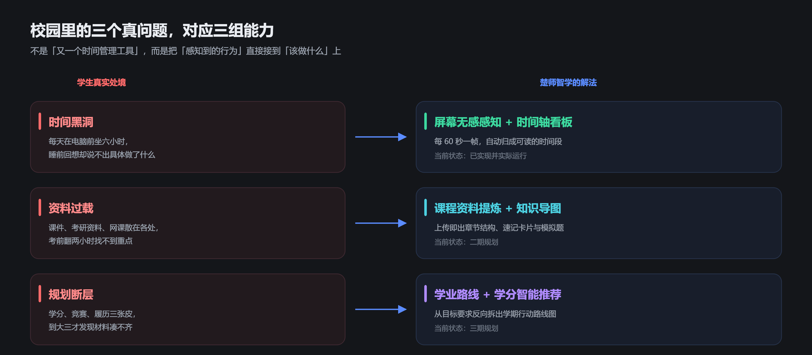
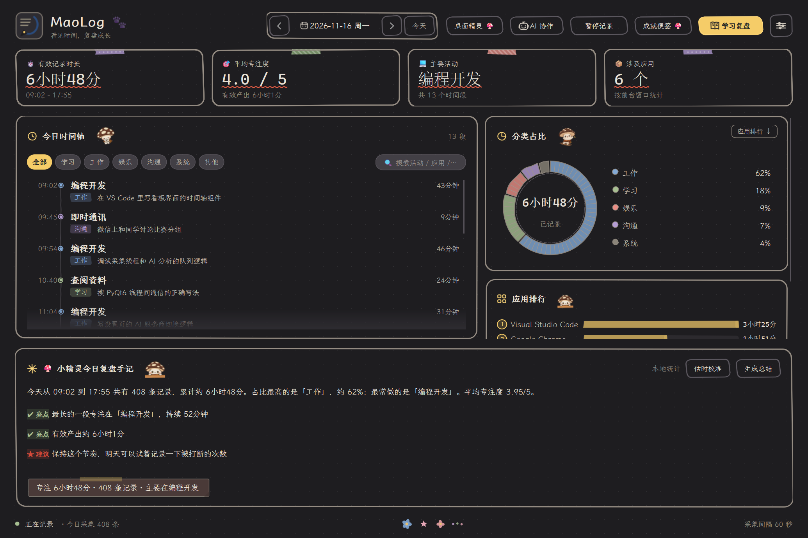
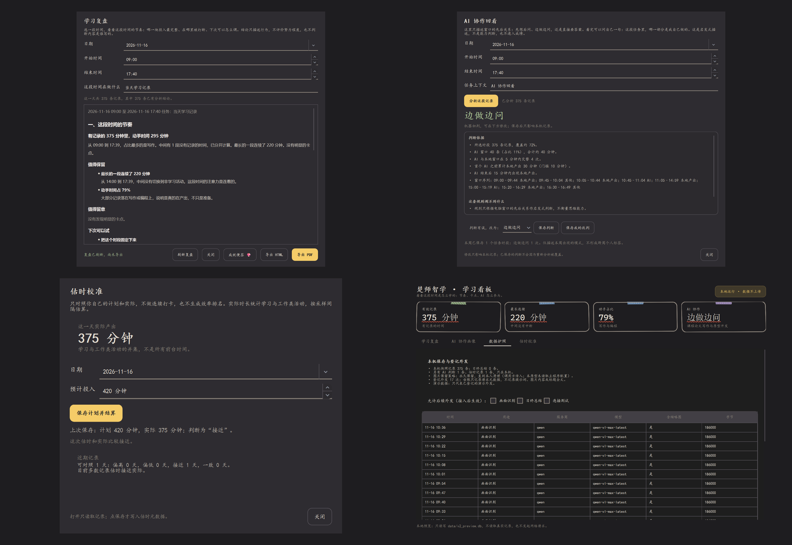
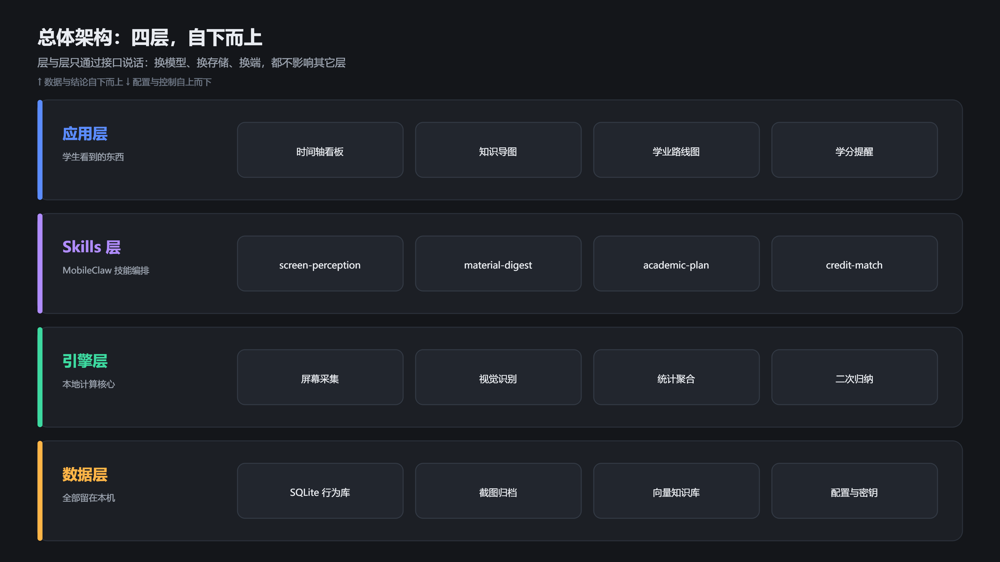
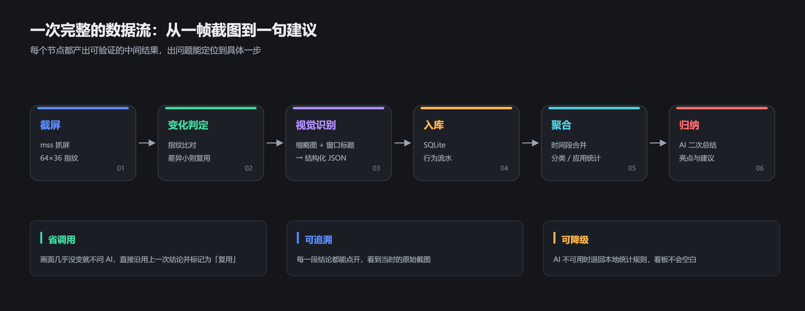
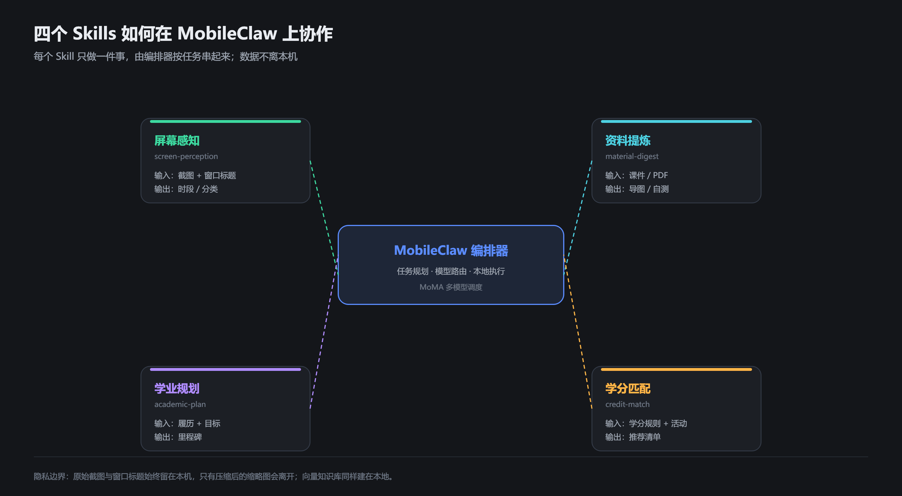
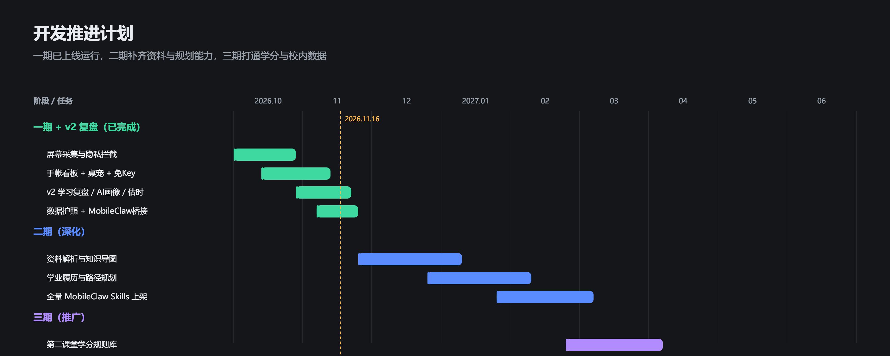

# 「楚师智学」

## 基于屏幕感知与 MobileClaw 的主动式 AI 个人学业管理平台

**参赛主题**：主题一「AI 赋能校园」——校园应用创意方案

**参赛单位**：楚雄师范学院 计算机与智能技术学院

**参赛形式**：个人赛

**参赛人**：李政寰　**学号**：20240524140　**班级**：2024级数字媒体技术班

**指导教师**：无

**提交日期**：2026 年 11 月 16 日

---

## 摘要

大学生每天面对电脑六到八小时，却普遍面临三个真实困境：时间流向缺乏客观记录、课程与考证资料分散难整理、学分及成长目标缺少可执行的学期规划。这些问题的本质不是「不够努力」，而是缺少一层把**日常行为、学习资料、成长目标**连接起来的个人基础设施。

「楚师智学」（程序名 `MaoLog`）以**本地屏幕无感感知**为数据源头，结合**视觉大模型 / 本地免 Key 规则引擎**与 **MobileClaw Skills 技能包编排**，在桌面端构建了一套隐私可控、低干扰的学业管理闭环：

1. **它先观察，再帮你看清自己**——程序后台按间隔感知屏幕与前台窗口，记录活动时间轴，并将行为序列进一步提炼为**学习过程复盘**（节奏断点与动手占比）、**AI 协作画像**（先思后问 / 边做边问 / 直接要答案）与**估时校准**，配套手帐风看板、蘑菇桌宠提醒与每日成就卡片；
2. **它把隐私锁在本机边界内**——截屏前命中排除名单直接放弃、原图不出本机、外发请求统一记入台账且可一键断网拦截，并可导出可核验的《数据护照》；
3. **它能无缝接入 MobileClaw 智能体生态**——通过已构建的 `chushi-zhixue-bridge` 技能包，把脱敏后的学习复盘 JSON 交给 MobileClaw（依托官方提供的 2500 万免费 Token 算力），进一步完成资料提炼、学期规划与第二课堂学分推荐。

截至 2026 年 11 月，本方案核心桌面端与 v2 复盘/隐私底座已全面开发完成并打包为免安装绿色版与单文件便携版（`core/`、`ui/`、`mobileclaw_skill/` 与 `main.py` 源码逾 1.7 万行，通过全部自动化测试验证）；课件资料提炼、全校制度知识库与第二课堂学分对接已形成明确数据结构与二期实施方案。

---

## 一、问题分析与项目定位

### 1.1 校园真实痛点与问题分析

大学阶段学习场景高度自主，学生在电脑前的投入缺少外部督促与结构化反馈，痛点主要集中在三方面：

**(1) 时间感知失真：说不清的一天**

一个典型下午常穿插写代码、查资料、回消息、看视频等多种切换。传统电脑统计软件只能按进程名记录「Code.exe 用了 90 分钟」，却不知道是在写实验报告还是发呆；而手写打卡与番茄钟需要人主动开启和归类，**需要长期坚持的工具往往最先被放弃**，事后回忆也容易高估有效专注时间。

**(2) 过程与协同盲区：不知道卡在哪里**

如今同学们普遍高频使用 AI 辅助写作与编程，但缺少两项自我觉察：一是**学习过程断裂点**（前期资料准备拖延、频繁被打断、同一文档反复回访）；二是**与 AI 的协作边界**（到底是先独立思考再提问、边做边问，还是直接向 AI 要答案），以及**时间估不准**造成的计划屡屡落空。

**(3) 资料过载与规划断层：三张皮凑不到一起**

课程 PPT、教材 PDF、板书照片、网课录屏散落各处；同时教务系统成绩、第二课堂学分办法、学科竞赛与考证（专升本 / 考研 / 四六级 / 就业）时间表彼此割裂。很多同学到了大三才发现创新创业或社会实践类学分不足、简历缺乏核心项目。



*图 1　校园三个真问题与平台能力的对应关系*

> **设计依据说明**：上述三类痛点源自高校日常学习场景的系统观察与同学交流反馈——传统工具依赖高成本手工维护，过程复盘与学分规划之间缺乏数据桥梁，亟需一款低门槛、本地优先的智能助手打通闭环。

### 1.2 项目定位与核心设计理念

「楚师智学」定位为**「用事实说话的学业助手，和可验证的成长教练」**，遵循四条硬性设计原则：

- **无感采集**：无需手动计时或打卡，后台按周期低占用读取屏幕状态，不打断学习心流。
- **可信推理**：时间轴每段结论均可追溯到当时的窗口信息与本地原图；AI 协作画像给出清晰判据并支持学生手动改判，拒绝黑箱打分。
- **隐私可控**：拦截在截屏之前、原图不出本机、外发可审计可拦截、数据全存本地单库随时可删。
- **即开即用与生态可扩展**：无 API Key 时自动启用本地规则引擎与纠偏记忆；配置模型或接入 MobileClaw 后，能力可平滑升级为全链路智能体工作流。

| 对比维度 | 传统番茄钟 / 计时器 | 常规窗口时间统计软件 | 手工学习日记 | 楚师智学（MaoLog） |
|---|---|---|---|---|
| 采集方式 | 需每次手动启动 | 自动记录进程名 | 每日回忆手写 | **无感自动采集 + 语义理解** |
| 粒度深度 | 仅计总时长 | 仅知道用了什么软件 | 主观易失真 | **明确到具体任务与专注度** |
| 过程与 AI 反思 | 无 | 无 | 靠主观感想 | **过程断点 + AI 协作画像 + 估时校准** |
| 数据外发与隐私 | 多依赖云端同步 | 本地记录为主 | 本地或云笔记 | **原图不出本机 + 外发台账与数据护照** |
| 下一步落地衔接 | 无 | 无 | 需自行规划 | **内置 Bridge Skill 对接 MobileClaw** |

*表 1　与常见时间管理方案的对比*

---

## 二、解决方案与核心功能设计

本平台功能分为「**已完成并可实机演示**（2.1–2.3 节部分能力）」与「**二/三期扩展规划**（2.3–2.4 节）」两大阶段，边界清晰，不虚夸进度。

### 2.1 【已实现】屏幕无感感知、手帐风看板与桌宠陪伴

#### 2.1.1 采集、过滤与识别引擎

后台通过 `RecorderWorker` 与 `AnalyzerWorker` 双线程解耦运行（以 SQLite 为异步队列，避免 AI 请求拖慢截屏节奏），单轮采集流程如下：

1. **前台窗口与进程解析**：通过 Windows API `GetForegroundWindow` 获取活动窗口标题与 PID；针对 UWP 系统应用自动解析真实子/父进程名，避免全部笼统记为应用宿主进程。
2. **截屏前隐私拦截**：若进程命中排除名单（默认含密码管理器等）或窗口标题命中敏感词（如「密码」「身份证」「银行卡」「支付」），在 `mss` 截屏前直接终止流程，**连一条跳过记录与标题都不会写入数据库**。
3. **图像压缩与灰度指纹复用**：保留 1600 宽 JPEG 原图与 360 像素缩略图在本地；同时生成 `64×36`（2304 字节）灰度指纹与上一帧逐字节比对。差异低于阈值（默认 `0.035`）时直接复用上次结论，使连续作业自动聚合为整段时光；同时设置最长复用 `20` 分钟上限，避免把两小时娱乐误判为连续工作。
4. **双模识别（视觉大模型 / 本地免 Key 引擎）**：
   - 接入通义千问 VL、智谱 GLM-4V、OpenAI 兼容接口或本地 Ollama 时，将压缩至 1024 宽的图片连同进程名、窗口标题发往模型，输出限定在六类（`工作 / 学习 / 娱乐 / 沟通 / 系统 / 其他`）的结构化 JSON（含 `activity`、`detail`、`focus_score`、`is_productive`）。
   - 未填写 API Key 或开启「本地免 Key 模式」时，由内置规则引擎按进程特征、网页关键词及用户历史纠偏记忆本地自动归类，零成本开箱即用。

#### 2.1.2 手帐风看板、蘑菇桌宠与日终总结



*图 5　手帐风主看板实机渲染界面（含分类筛选、环形占比、应用排行与 AI 总结）*

- **手帐风视觉界面**：采用温暖纸张网格底纹、手绘胶带/贴纸涂鸦装饰、四张概览卡片（记录时长、平均专注度、核心活动、涉及应用）、时间轴（支持六类快速筛选、关键词检索、右键就地改分类并记住规则、点击弹出原图回看）、环形分类图、应用耗时排行与日历翻天视图。
- **蘑菇小精灵桌面陪伴**：轻量级无边框透明悬浮桌宠，随录制/分析/暂停状态呈现呼吸、歪头、弹跳与「Zzz」休眠动画；结合当日学习时长与连续专注阈值主动冒出温和关怀气泡，并支持快捷召唤看板、每日手帐风**成就卡片**生成与托盘联动。
- **两步压缩 AI 日终总结**：为防止长文本塞满上下文，程序先将全天聚合为最多 40 段的轻量文本摘要，再交由模型归纳出 120–200 字总结、亮点与改进建议；离线或未配 Key 时自动回退为基于真实数据的本地统计总结。
- **工程稳定性与反卡死保障**：已针对实机高频使用场景完成专项优化——SQLite WAL 模式仅在建库首连配置以避免读查询抢写锁；跨线程停机改用安全队列调度与可中断 HTTP 会话；看板信号防抖合并、桌宠静置降频重绘，确保长时间挂载及退出均秒级响应不卡死。

### 2.2 【已实现】学习过程复盘、AI 协作画像、估时校准与数据护照

在基础时间轴之上，v2 版本已完整落地一套专门服务学业成长的「过程反思与隐私守护」闭环模块，均可通过主看板入口或隔离演示看板实机体验：



*图 7　已实现的 v2 四大核心对话界面：学习复盘 / AI 协作回看 / 估时校准 / 数据护照*

**(1) 学习过程复盘与 HTML/PDF 导出**

选定任意任务与时段后，系统把离散快照重组为「写作 / 阅读 / 查阅 / 编程 / AI 对话 / 其他」阶段序列（间隔超过 3 倍采样周期自动标为数据缺口，不作主观脑补），自动诊断**最长连续投入段**、**动手占比**、**打断次数**、**启动准备时长**与**同文档回访率**，给出无说教的节奏亮点与调整建议，并支持导出排版精良的**学习复盘 HTML / PDF 报告**（默认不含截图与窗口标题原文）。

**(2) AI 协作画像（可查看证据、支持改判）**

按时间窗内 AI 工具与本地产出窗口（IDE、Word/WPS 等）的前后切换与覆盖度，启发式识别三种协作形态：
- **先思后问**：使用 AI 前已有至少 10 分钟连续本地产出；
- **边做边问**：5 分钟窗内 AI 与本地产出交替 ≥ 3 次；
- **直接要答案**：AI 窗口占比较高且结束前后 15 分钟内未见本地动笔。

所有判断均附透明量化依据与周内分布汇总；学生随时可结合真实情景手动改判，系统保留机器原判作对比。

**(3) 估时校准**

支持记录当日「计划产出分钟数」，自动对照「学习 + 工作类实际产出分钟数」结算偏差（高于实际 / 接近 / 低于实际）与近期偏高/偏低趋势，帮助学生修正「一天总想塞进十件事」的计划幻觉。

**(4) 实时外发台账与《数据护照》**

在「隐私与数据护照」设置中，学生可按用途（画面识别 / 日终总结 / 连接测试）独立启停外发权限：开启管控后，每次真实外发只记录时间、服务商、模型、用途与字节数（绝不存提示词与图片），未授权用途在请求发出前即被硬拦截；并可随时导出一份机器可核验的 **JSON《数据护照》**，写明声明覆盖边界与本机规则。

### 2.3 【已建桥接 / 二期深化】MobileClaw Skills 与学业路线规划

为避免停留在「概念口号」，仓库已在 `mobileclaw_skill/chushi-zhixue-bridge/` 实现可运行的 **MobileClaw 桥接技能包**：

- 提供标准 `SKILL.md` 声明与 `scripts/export_bridge.py` CLI 脚本；
- 脚本直接读取本地 SQLite 行为库并联动 `attest`、`learning_review`、`ai_profile`、`time_estimate` 模块，导出严格不含截图路径与窗口标题的 `chushi-zhixue.mobileclaw-bridge.v1` JSON 数据包与现成上下文摘要；
- MobileClaw 桌面智能体可直接读取该脱敏包，依托其 2500 万免费 Token 与微信/飞书消息通路，自动推送「晚间学习节奏简报」与「明日时间块安排」。

在此数据源基础上，二期将补齐**个人履历与学业路线规划模块**（`academic-plan` Skill）：面向专升本、考研、四六级、就业、学科竞赛五类校园目标，把「我想考研 / 想过六级」拆成带截止时间节点的具体动作：

| 目标类型 | 关键能力与基线指标 | 主要投入期 | 屏幕感知检验信号 |
|---|---|---|---|
| 专升本 | 专业课分数、英语基础、目标院校录取线 | 大二下 – 大三上 | 专业课刷题与网课连续时长 |
| 考研 | 初试科目、绩点排名、竞赛/科研加分项 | 大三上 – 大四上 | 数学/专业课深专注段比例 |
| 四六级 | 词汇量、真题正确率、听力精听投入 | 每学期考前 8 周 | 听力阅读整块投入频率 |
| 就业 | 实战项目数、技术栈匹配度、实习投递 | 大三下 – 大四 | IDE 编码与项目文档占比 |
| 学科竞赛 | 赛事级别、历年真题、团队分工与提交期 | 全年按赛历推进 | 作品冲刺期夜间异常娱乐预警 |

*表 2　五类校园成长目标的画像结构与行为校验维度*

系统读取学生已修成绩、竞赛获奖与社团履历后，对照制度知识库输出带优先级的「差距清单」（如高数基础、英语等级、竞赛级别差距），再结合学分进度生成可执行的学期行动路线。每周复盘时，如果屏幕感知发现「学习类占比连续下降、拟复习科目未见实际打开记录」，系统即在周报与 MobileClaw 消息中提示偏航，实现**「计划制定 → 行为采集 → 执行校验 → 纠偏提醒」**的闭环。

下方为本技能包 `export_bridge.py` 在隔离演示库（375 条记录）上实际生成的脱敏输出片段，MobileClaw 可直接消费：

```json
{
  "schema": "chushi-zhixue.mobileclaw-bridge.v1",
  "privacy_guarantee": {
    "raw_screenshots_included": false,
    "window_titles_included": false,
    "raw_prompts_included": false
  },
  "overview": { "records": 375, "tracked_minutes": 375.0, "avg_focus": 4.57 },
  "learning_review": {
    "headline": "有记录的 375 分钟里，动手时间 295 分钟",
    "stage_switches": 9,
    "document_revisits": 3
  },
  "ai_collaboration": { "mode": "边做边问" },
  "time_estimate": { "planned_minutes": 420, "actual_minutes": 375 }
}
```

> **参数配置机制**：上述五类目标画像参数均采用可配置的外置规则模板，后续可根据各专业培养方案与当年考证、升学招考政策灵活调整基线指标。

### 2.4 【规划中】课件资料提炼与第二课堂学分智能推荐

- **课程资料提炼（`material-digest` Skill）**：针对考前「一门课 12 个 PPT 加扫描教材和板书照片找不到重点」的痛点，二期规划引入纯文本优先的多格式抽取引擎（PPTX/PDF 走结构化解析保留标题层级，扫描版 PDF 与板书照片再调视觉大模型），在本地向量库中按章节语义切块并保留来源页码，一次解析同步输出四种考前复习视图：
  1. **章节知识导图**：保留「章—节—知识点」结构及前置依赖 `prerequisites`，点击任意考点直接跳回原课件页码；
  2. **考点速记卡片**：正面为提问、背面为精炼答案与页码出处，并支持导出 Anki 兼容格式（`.apkg` / CSV），复用成熟遗忘曲线工具而不重复造轮子；
  3. **薄弱点溯源模拟题**：自动生成选择、填空与简答题，错题反向归因到导图节点并标红，考前重点复习红色区域；
  4. **考前 A4 重点清单**：按「必考 / 常考 / 了解」排序，便于进考场前两小时速览。
- **第二课堂学分推荐（`credit-match` Skill）**：针对学生「大一不了解、大三发现某一类缺分来不及补」的共性问题，三期计划构建本校第二课堂学分规则库，实时计算思想政治、社会实践、创新创业、文体活动等分项完成度（例如提示「创新创业类 1/3，缺 2 分」），再结合报名截止期、学生兴趣标签以及屏幕感知推断出的空闲时段，自动筛选不冲突且可认定加分的校园活动与比赛。

> **规则外置说明**：制度知识库采用结构化 JSON / Markdown 外置文件维护，对照学校现行《第二课堂学分认定与管理办法》及各专业培养方案分类要求进行标准配置与版本更新。

---

## 三、系统架构、AI 应用方式与隐私保障

### 3.1 四层解耦总体架构

系统坚持**「分层依赖、核心在本地、模型与生态可插拔」**的设计，自下而上分为四层：



*图 2　总体架构：数据层 / 引擎层 / Skills 层 / 应用层*

1. **数据层**：纯本地文件体系（`activity.db` 行为与 v2 元数据单库、`screenshots/` 归档、`config.json`、二期课程向量库），零外部数据库安装门槛，拷走即备份、删除即清零。
2. **引擎层**：屏幕采集与隐私前置闸门、视觉与本地分类双引擎、过程序列与 AI 画像分析器、安全导出与外发台账控制器。
3. **Skills 层**：对外暴露标准化、脱敏后的能力接口（目前 `chushi-zhixue-bridge` 已运行；`material-digest`、`academic-plan`、`credit-match` 纳入 MobileClaw 编排体系）。
4. **应用层**：手帐风 PyQt6 主看板、蘑菇桌宠、复盘/画像/估时弹窗及隔离演示模式，并已通过 PyInstaller 封装为文件夹版与单文件便携版（`.exe`）。

### 3.2 AI 应用方式与本地智能协同

本平台不是「做一个套壳聊天框」，而是让 AI 承担最耗人力的**多模态场景理解、过程归纳与结构化抽取**：

| 环节 | 输入信息 | AI 作用与提示词/规则策略 | 兜底与省流设计 |
|---|---|---|---|
| **画面语义识别** | 1024px 缩略图 + 进程名 + 窗口标题 | 限制输出 6 类固定 JSON，提示词结合软件上下文区分写代码/查文档/看视频 | 灰度指纹变化 < 0.035 直接复用；无 Key 启用本地规则与纠偏记忆 |
| **日终总结归纳** | 聚合后的 ≤40 段全天节奏摘要 | 引导模型结合真实任务名称、高峰时段给出 120–200 字评述与具体建议 | 模型失败或离线时自动切换本地统计总结，展示不中断 |
| **MobileClaw 桥接规划** | 脱敏学习复盘与估时偏差 JSON | 由 MobileClaw 智能体读取上下文，生成周度微调建议并推送微信/飞书 | 严格拦截截图、原提示词与原始窗口标题出域 |
| **资料与学分 RAG（规划）** | 课件文本块 / 校内制度条文 | 向量相似度 + 关键词混合检索，按章节点出处生成导图、卡片与活动匹配 | 优先抽取纯文本，token 成本仅约为全图识别的 1/10 |



*图 4　端到端数据流：从屏幕感知、指纹复用、AI 识别到看板呈现*

### 3.3 MobileClaw 生态与算力融合



*图 3　四个 Skills 在 MobileClaw 上的协作编排关系*

大赛鼓励基于**中国移动 MobileClaw** 落地应用。本方案与其高度契合：
- **本地优先同频**：MobileClaw 强调本地优先执行与数据自主，与本平台「原始截图不出本机」理念一致；
- **Skills 职责正交**：四个核心能力模块拆分清晰，既可单独测试，又能串联「日常感知 → 复盘纠偏 → 规划推进 → 行为检验」闭环；
- **低成本持续算力支撑**：按每日 8 小时、60 秒采样计，约 480 次/天，经 40% 左右静置画面指纹复用后，实际约 290 次/天；每次压缩缩略图约 1–2k tokens，单日约 30–50 万 tokens。参赛免费领取的 **MobileClaw 2500 万 Token** 足以稳定支撑单个学生连续数月高频使用与实机演示。

### 3.4 隐私与内容安全五道防线

会截屏的软件必须讲清信任边界。系统在代码执行顺序中写死了五层保护：
1. **截屏前硬拦截**：命中隐私软件名或敏感词窗口直接跳过，不抓图、不入库；
2. **原图不出本机**：仅发压缩图用于识别，高清截图只留在用户本地磁盘并支持 N 天自动清理；
3. **本地指纹先过滤**：2304 次内存整数减法判断变化，不动网络、不泄隐私；
4. **外发审计与一键断网**：v2 外发台账逐笔登记时间/字节/模型/用途，`enforce=True` 时可按类别彻底阻止外发；
5. **一键可携与销毁**：提供本地单库文件导出与随时删库，所有演示脚本内置与真实库 `activity.db` 物理隔离机制。

---

## 四、典型校园应用闭环示例

### 4.1 日常学习与晚间复盘（已可实机演示）

大二同学周三上午在 VS Code 编写课程设计、浏览器查 PyQt6 线程资料并调试程序，下午写作并穿插短时视频放松。使用 `MaoLog` 后：

1. **白天零操作**：桌面右下角蘑菇小精灵安静陪伴，每 60 秒无感记录。
2. **晚间 1 分钟复盘**：打开手帐看板，时间轴直观展示 7 段真实行为、专注最长的 52 分钟编码段及 38 分钟「无意多刷的视频」；点击任一段还能弹出原图自证。
3. **导出过程卡片与协作画像**：使用「学习复盘」生成结构化节奏 PDF 留作过程反思，或通过 `export_bridge.py` 导出脱敏 JSON 交给 MobileClaw，收到明日建议：「将高数/核心编码固定在下午专注高效期，午休后设定 15 分钟闹钟防止视频超时」。

### 4.2 考试复习与学期规划（二、三期扩展场景）

考前两周导入 12 份《数据结构》课件与板书照片后，系统先抽文本生成带原文页码溯源的导图与 Anki 速记卡片，错题自动定位至「图的最短路径」薄弱节点；学期初设定「考研 / 专升本 / 四六级 / 竞赛」目标并核对第二课堂学分进度后，平台拆出带截止日期的里程碑清单，并在半学期后依据真实屏幕学习时长占比自动预警偏航。

---

## 五、技术可行性、项目进展与推广计划

### 5.1 工程选型与技术可行性

桌面端坚持**轻量、独立运行、无外部服务依赖**，已实现部分的关键技术选型均经过实机验证：

| 技术组件 | 选型方案 | 核心工程考量 |
|---|---|---|
| 界面与渲染 | Python 3.13 + PyQt6 | 跨平台生态完备、QPainter 自绘手帐控件与图表无需引入重型前端/图表依赖 |
| 屏幕与窗口感知 | `mss` + Windows API + `psutil` | 毫秒级多屏抓图，配合父/子进程追溯准确识别 UWP 与浏览器真实名称 |
| 本地存储队列 | SQLite（WAL 模式） | 单文件零配置，双线程读写解耦且支持学生一键整库拷贝或彻底销毁 |
| 视觉与规则识别 | 多服务商统一适配 + 本地规则引擎 | 统一 `/chat/completions` 接口支持 4 类服务商，无 Key 时自动降级本地规则引擎 |
| 隐私与安全导出 | 前置拦截 + 外发台账 + Qt PDF | 原图本地保存，复盘 HTML/PDF 与 MobileClaw JSON 均经过路径越界校验与脱敏 |

*表 3　系统核心技术栈与工程选型*

### 5.2 已有成果与工程验证（截至 2026-11-16）



*图 6　项目开发进度与三期推进计划（当前节点：2026-11-16）*

目前项目已超额完成原定一期全部功能，并提前完成 v2 学习复盘与 MobileClaw 桥接核心代码：

- **软件规模与形态**：覆盖 `core/`、`ui/`、`mobileclaw_skill/` 与 `main.py`，已使用 PyInstaller 打包为免安装文件夹版 `MaoLog.exe` 与 74 MB 级单文件便携版 `MaoLog_便携版.exe`，支持 Windows 双击即用与一键托盘驻留。
- **自动化验证通过**：`test_startup.py`（启动页时序）、`test_fixes.py`（长总结防截断 / 安全目录边界 / 暂停回补 / 限流重试）、`test_v2.py`（学习复盘、AI 协作 13 项边界、数据护照、外发硬拦截、估时校准、隔离演示与旧库升迁）全部实测通过；`export_bridge.py` 已在隔离演示库完成端到端 JSON 导出验证。
- **实机体验打磨**：完成 Windows 平台并发 SQLite WAL 抢锁消解、HTTP 超时可中断退出及高帧率透明窗体降频，消除卡死与退出残留隐患。

### 5.3 预期成效与校园推广路径

- **短期（赛后 1 学期内）**：在本院大一至大三招募 30–50 名同学使用便携版体验「无感时间轴 + 学习复盘 + MobileClaw 日报推送」，回收试用问卷与行为趋势反馈（仅聚合不暴露个体），目标两周留存率 ≥ 60%。
- **中期（2027 上半年）**：补齐课件 RAG 提炼（PDF/PPTX 最小闭环先行，验证抽取精度后再扩图谱）与第二课堂规则库校对，联动学工与学院试点活动匹配推荐。
- **可复制性**：核心感知与复盘引擎完全独立于学校；对外推广仅需替换各校培养方案与第二课堂规则库知识文档，具备低门槛向校内外复制的潜力。

---

## 附录：实机交付物清单

| 类别 | 交付内容 / 路径 | 说明 |
|---|---|---|
| **方案文档与配图** | `楚师智学-参赛方案说明书.docx`、`实机与架构配图/` | 含完整方案设计、四层架构图与手帐看板实机截图 |
| **桌面端可执行程序** | `可演示原型与源码/MaoLog_便携版.exe` | 免安装单文件便携版，Windows 双击即用并支持本地免 Key 运行 |
| **核心源码与技能包** | `core/`、`ui/`、`main.py`、`mobileclaw_skill/chushi-zhixue-bridge/` | 含桌面看板、v2 复盘底座源码与 MobileClaw 脱敏桥接脚本 |
| **自动化验证套件** | `tools/test_startup.py`、`tools/test_fixes.py`、`tools/test_v2.py` | 覆盖启动流程、数据安全、AI 协作与防截断回归测试 |
